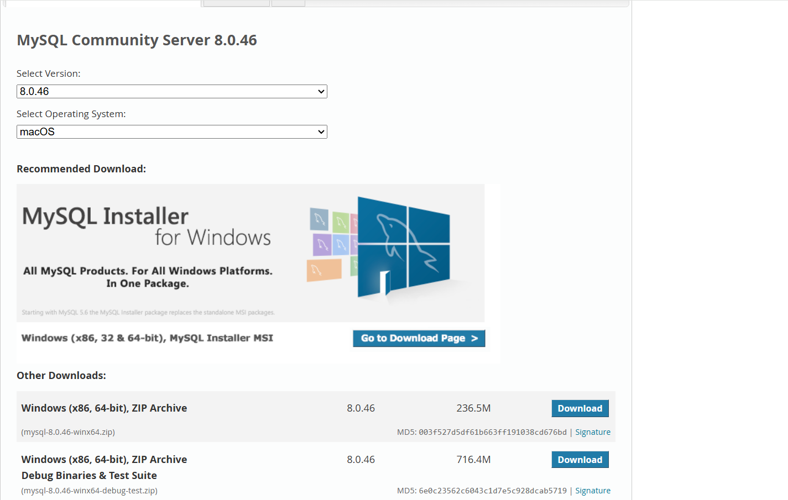
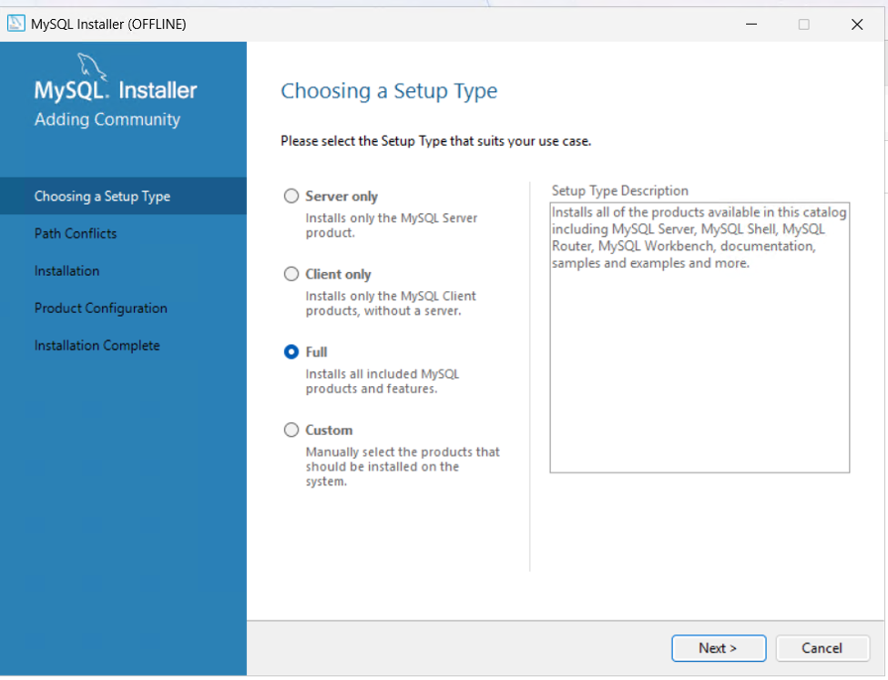
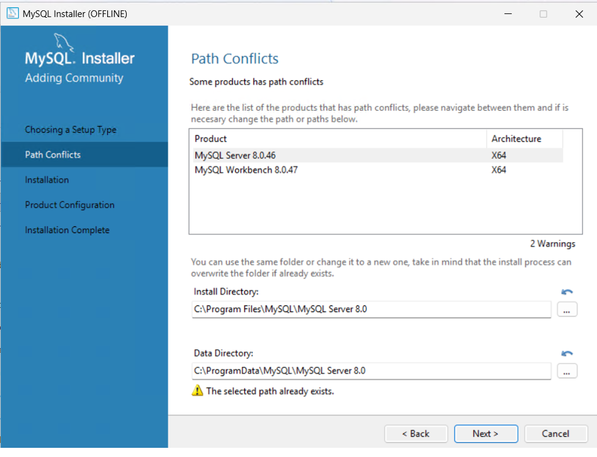
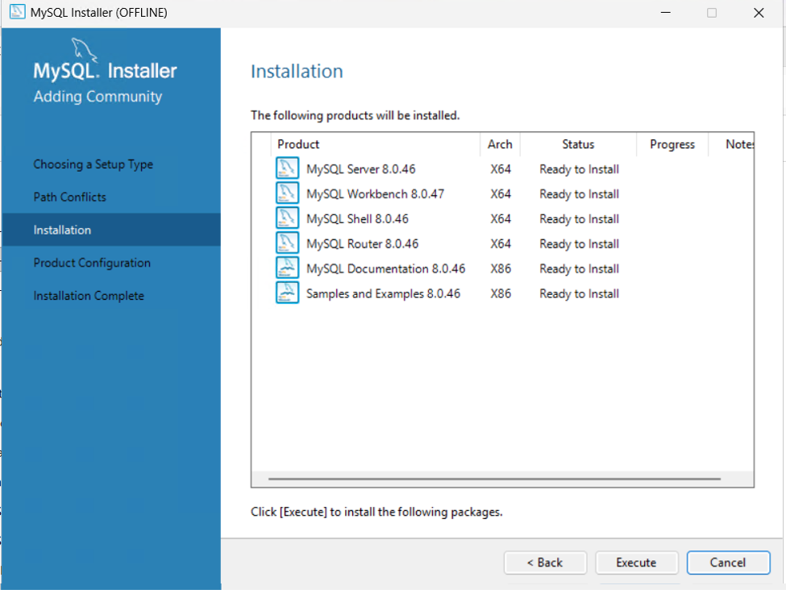

# MySQL Installation Guide (Windows)

## Step 1: Download MySQL Installer

1. Open the official MySQL download page:

   https://dev.mysql.com/downloads/installer/
3. You will see two installation options:

   

| Installation file | Description |
|---|---|
| mysql-installer-web-community-8.0.46.0.msi | **Web Installer:** A small installation file. An internet connection is required because the necessary MySQL components will be downloaded during installation. |
| mysql-installer-community-8.0.46.0.msi | **Full Installer:** Includes the installation packages locally. You can install MySQL without downloading the components during setup. |

### Which one should you download?

- Choose the **Web Installer** if you have a reliable internet connection.
- Choose the **Full Installer** if you want to download all installation components ahead of time or install on a computer without internet access.

Both options use the MySQL Installer to guide you through the installation process.

## Step 2: Run the MySQL Installer

1. Once the download is complete, locate the downloaded .msi file in your **Downloads** folder.
   
   
   
3. Double-click the file to launch the MySQL Installer.
5. If Windows asks for permission to make changes to your device, click **Yes**.
6. Wait for the installer to initialize.

## Step 3: Choose the Setup Type

The installer will ask you to select a setup type.

The available options include:

| Setup Type | Description |
|---|---|
| Developer Default | Installs MySQL Server, MySQL Workbench, and other development tools. |
| Server Only | Installs only the MySQL database server. |
| Client Only | Installs client applications such as MySQL Workbench, without the server. |
| Full | Installs all available MySQL products. |
| Custom | Allows you to select individual MySQL components. |

**Recommendation:** Select **Developer Default** if you plan to develop applications or work with databases using MySQL Workbench.

Click **Next**.

## Step 4: Install MySQL Products

1. The installer will check whether your computer has the required software.

3. If any requirements are missing, click **Execute** to install them.
   

5. Once the requirements are satisfied, click **Next**.
6. Click **Execute** to begin installing the selected MySQL products.
7. Wait until all products show a successful installation status.
8. Click **Next** to continue.

## Step 5: Configure MySQL Server

After installation, you will be prompted to configure MySQL Server.

1. Select the default configuration options unless you have specific requirements.
2. Select **Standalone MySQL Server** if prompted.
3. Configure the server type and connectivity settings.
4. Keep the default port as 3306, unless another application is already using it.
5. Select the authentication method. The recommended option is to use strong password encryption.
6. Create a password for the MySQL root account.

**Important:** Remember your root password. You will need it when connecting to your MySQL database.

## Step 6: Complete the Configuration

1. Configure MySQL to run as a Windows service.
2. Keep the option to start MySQL Server when Windows starts enabled.
3. Click **Execute** to apply the configuration.
4. Wait until all configuration steps are completed successfully.
5. Click **Finish**.

## Step 7: Verify the Installation

To make sure MySQL has been installed correctly:

1. Open the Windows Start menu.
2. Search for and open **MySQL Workbench**.
3. Locate the local MySQL connection (usually named Local instance MySQL80).
4. Double-click the connection.
5. Enter the root password you created during installation.

If the connection opens successfully, MySQL is installed and ready to use.

You can also run the following SQL statement to verify that the database server is responding:

sql
SELECT VERSION();

This should return the installed MySQL version.

---

## Additional Resources

- [MySQL 8.0 Reference Manual](https://dev.mysql.com/doc/refman/8.0/en/)
- [MySQL Workbench Documentation](https://dev.mysql.com/doc/mysql-workbench/en/)
- [MySQL Installer Documentation](https://dev.mysql.com/doc/refman/8.0/en/mysql-installer.html)

---

## Installation Recommendation

For students and beginners, use the **Developer Default** installation. This installs both MySQL Server and MySQL Workbench, providing everything needed to get started with database development.
