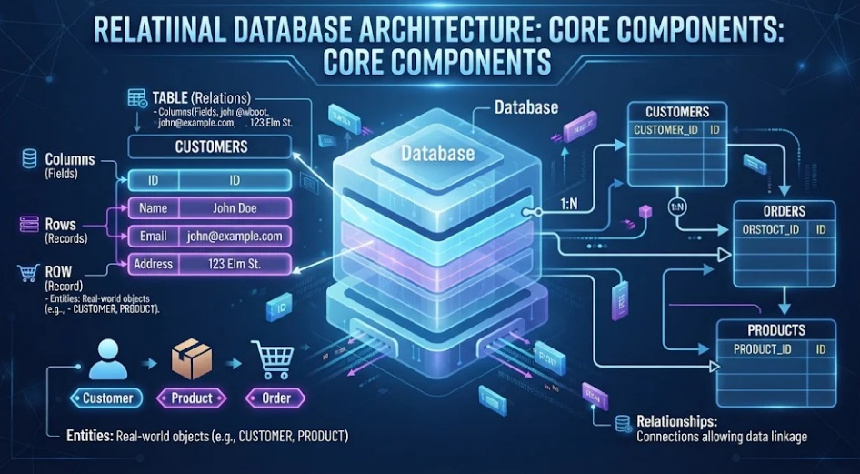
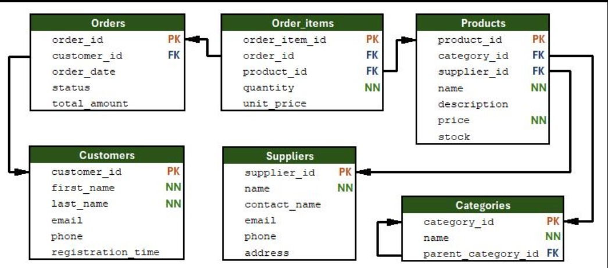
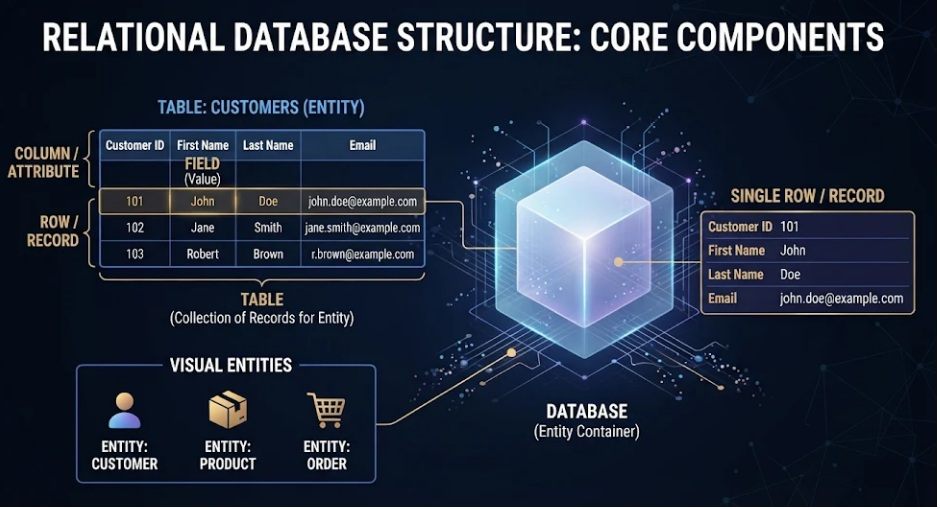
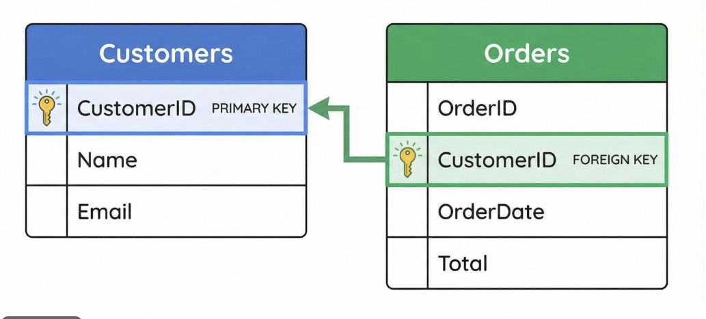

## 2.2 Relational Databases

A **relational database** is a database management system that organizes information into tables consisting of rows and columns.

These tables can be connected through relationships, allowing information to be stored efficiently, reducing unnecessary data duplication, and making it easier to retrieve related information.

Relational databases are widely used in business applications, financial systems, e-commerce platforms, and information management systems.

### Examples of Relational Database Management Systems (RDBMS)

- MySQL
- PostgreSQL
- Microsoft SQL Server
- Oracle Database

## 2.3 How Are Relational Databases Organized?

A relational database consists of multiple tables, also known as *relations*. Each table stores information about a particular subject or entity.

For example, an online store might organize its information into separate tables:

- **Customers:** Stores customer information.
- **Products:** Stores product details.
- **Orders:** Stores customer order information.
- **Payments:** Stores payment transactions.

Instead of storing all information in one large table, relational databases separate information into related tables. This approach improves organization and makes data management more efficient.

### Key Components of a Relational Database

| Component | Description |
|---|---|
| **Tables (Relations)** | Structures used to organize and store data. |
| **Rows (Records)** | Individual entries within a table. Each row represents a record. |
| **Columns (Fields)** | Define the attributes or properties of the stored information. |
| **Entities** | Real-world objects or subjects represented in the database, such as customers, products, and orders. |
| **Relationships** | Connections between tables that allow related information to be linked. |

## 2.4 Relationships and Referential Integrity

Relational databases use relationships to connect information stored in different tables.

These relationships help maintain **referential integrity**, which means that references between related records remain valid and consistent.

For example, an order should reference an existing customer rather than a customer who does not exist in the Customers table.

Relationships are commonly established using:

- **Primary Key (PK):** A column or combination of columns that uniquely identifies each record in a table.
- **Foreign Key (FK):** A column or combination of columns that references a key in another table, establishing a relationship between the tables.

  

## 2.5 Key Takeaways

By the end of this section, students should understand that:

1. Databases come in different types, each designed to organize and manage information differently.
2. Relational databases organize information into tables containing rows and columns.
3. Tables represent different entities, such as customers, products, and orders.
4. Relationships connect tables and allow related information to be retrieved.
5. Primary keys and foreign keys help establish relationships and maintain data integrity.
6. SQL is the language commonly used to communicate with relational databases.
