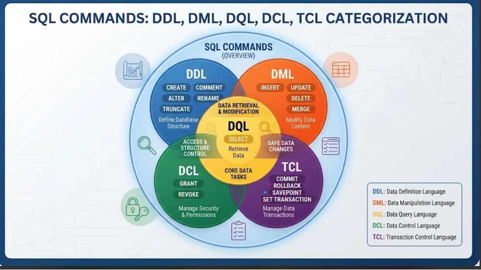

# SQL – Structured Query Language

## 1\. What is SQL?

**SQL (Structured Query Language)** is a standard language used to communicate with relational database management systems (RDBMS), such as MySQL. It is pronounced either like “sequel” or by saying each letter, as in “ess cue el.” SQL is used to access, manipulate, and retrieve data from objects (Tables. Views, functions etc ) in a database. Databases can have one or more schemas, which provide the organization and structure and contain other objects. SQL is used to:
- Create and manage databases.
- Create and manage tables.
- Insert records into tables.
- Retrieve information from databases.
- Update existing records.
- Delete records.
- Manage database permissions.
- Control database transactions.

## 2\. Types of SQL Languages

SQL commands are divided into five main categories:

| Category | Full Form | Purpose | Common Commands |
| --- | --- | --- | --- |
| DDL|  [Data Definition Language Commands](ddl_commands.md)  | |CREATE, ALTER, DROP, TRUNCATE |
| DML | [Data Manipulation Language Commands](dml_commannds.md) | Adds, modifies, and deletes table records. | INSERT, UPDATE, DELETE |
| DQL| [Data Query Language Commands](dql-commands.md) | Retrieves information from database tables. | SELECT |
| DCL| [Data Control Language](dcl_commands.md) |  Manages database access and permissions. | GRANT, REVOKE |
| TCL | [Transaction Control Language Commands](tcl_commands.md) | Manages database transactions. | COMMIT, ROLLBACK, SAVEPOINT |

