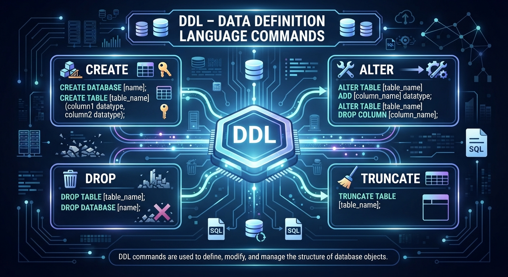

# DDL – Data Definition Language Commands

DDL is used to create, modify, and delete database structures, such as databases and tables.



## 1\. DDL Commands Summary

| DDL Command | Description | Example |
| --- | --- | --- |
| **CREATE DATABASE** | Creates a new database. | Creates a database named School. |
| **CREATE TABLE** | Creates a new table in a database. | Creates a table named Students. |
| **ALTER TABLE** | Modifies the structure of an existing table. | Adds a new column to Students. |
| **DROP DATABASE** | Permanently deletes a database and its contents. | Deletes the School database. |
| **DROP TABLE** | Permanently deletes a table and its contents. | Deletes the Students table. |
| **TRUNCATE TABLE** | Removes all records while keeping the table structure. | Removes all records from Students. |
| **RENAME TABLE** | Changes the name of an existing table. | Renames Students to StudentRecords. |

---

###  CREATE DATABASE

Creates a new database.

sql

```sql
CREATE DATABASE School;
```

### CREATE TABLE

Creates a new table inside the School database.

```sql
CREATE TABLE Students (
    ID INT,
    Name VARCHAR(50),
    Age INT
);
```

###  ALTER TABLE

Adds a new column to an existing table.

```sql
ALTER TABLE Students
ADD Email VARCHAR(100);
```

### DROP DATABASE

Deletes the entire School database.

```sql
DROP DATABASE School;
```

### DROP TABLE

Deletes the Students table.

```sql
DROP TABLE Students;
```

### TRUNCATE TABLE

Removes all records from the Students table but keeps the table structure.

```sql
TRUNCATE TABLE Students;
```

### RENAME TABLE

Changes the table name from Students to StudentRecords.

```sql
RENAME TABLE Students TO StudentRecords;
```

---

