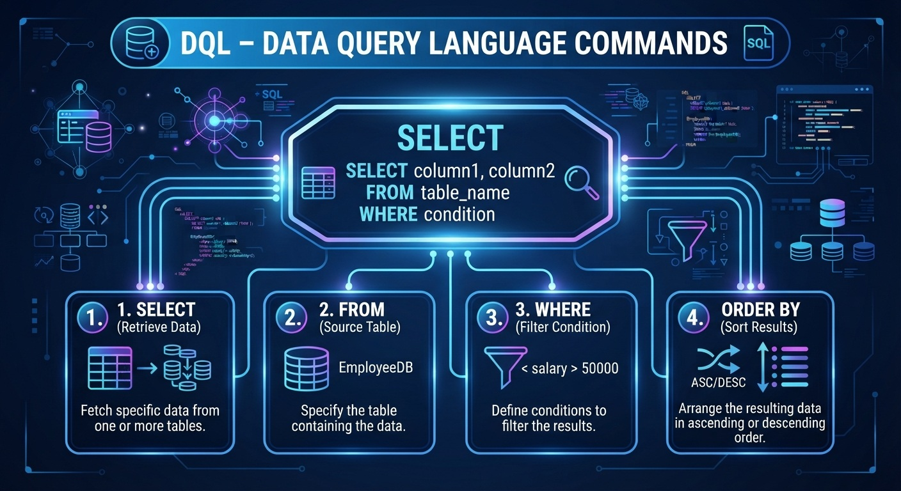

# DQL – Data Query Language Commands

DQL is used to retrieve, filter, sort, and display information stored in database tables.

Data Query Language (DQL) is used to retrieve and query data from a database. Its primary command is SELECT, which allows users to request specific information from database tables and views.

SQL queries can range from simple, single-line statements to complex queries involving multiple tables, joins, and schemas within the same database. Although SQL generally does not support querying across separate databases directly, additional software or network configurations can enable access to multiple data sources.

Unlike scripting languages, SQL queries are self-contained and generally do not rely on variables or outputs from previous steps



### DQL Commands and Clauses Summary

| Command / Clause | Description | Example / Purpose |
| --- | --- | --- |
| **SELECT** | Retrieves data from one or more tables. | Displays student records. |
| **DISTINCT** | Removes duplicate values from query results. | Displays unique student names. |
| **WHERE** | Filters records based on a condition. | Finds students older than 18. |
| **AND** | Combines conditions; all must be true. | Finds students older than 18 AND in grade 12. |
| **OR** | Combines conditions; at least one must be true. | Finds students in grade 11 OR grade 12. |
| **NOT** | Reverses a condition. | Finds students NOT in grade 12. |
| **IN** | Matches values from a specified list. | Finds students in selected grades. |
| **BETWEEN** | Finds values within a specified range. | Finds students aged between 18 and 22. |
| **LIKE** | Searches for a specified pattern. | Finds names starting with J. |
| **IS NULL** | Finds records containing NULL values. | Finds students without an email address. |
| **IS NOT NULL** | Finds records that do not contain NULL values. | Finds students with an email address. |
| **ORDER BY** | Sorts query results in ascending or descending order. | Sorts students by name. |
| **GROUP BY** | Groups records with matching values. | Groups students by grade. |
| **HAVING** | Filters grouped results. | Displays grades with more than 10 students. |
| **LIMIT** | Restricts the number of records returned. | Displays the first 5 students. |
| **AS** | Assigns a temporary name (alias) to a column or table. | Displays Name as Student\_Name. |


### SQL Code Examples

Assume we have a table named `Students`.

### SELECT – Retrieve All Records

```sql
SELECT * FROM Students;
```

### WHERE – Filter Records

```sql
SELECT * FROM Students
WHERE Age > 18;
```

### DISTINCT – Remove Duplicates

```sql
SELECT DISTINCT Age
FROM Students;
```

### ORDER BY – Sort Records

```sql
SELECT * FROM Students
ORDER BY Name ASC;
```

### GROUP BY – Group Records

```sql
SELECT Age, COUNT(*)
FROM Students
GROUP BY Age;
```

### HAVING – Filter Grouped Records

```sql
SELECT Age, COUNT(*)
FROM Students
GROUP BY Age
HAVING COUNT(*) > 1;
```

### LIMIT – Restrict Results

```sql
SELECT * FROM Students
LIMIT 5;
```

