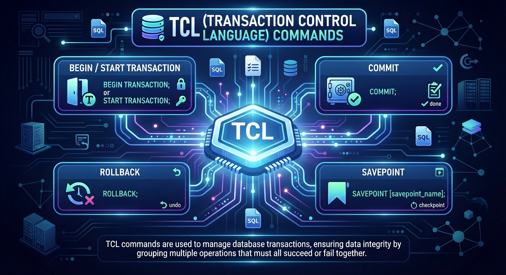

# MySQL Transaction Control Language (TCL) – Complete Reference Guide

Transaction Control Language (TCL) consists of SQL commands used to manage database transactions and control changes made to the database.

TCL commands allow you to save changes permanently, undo modifications, and establish intermediate points within a transaction. They play an important role in maintaining data consistency and ensuring reliable database operations.

In MySQL, transaction control is particularly important when working with transactional storage engines such as InnoDB.

This guide covers the main TCL commands, their syntax, practical examples, and best practices for managing database transactions.




###  Introduction to TCL

**Transaction Control Language (TCL)** consists of SQL commands used to manage database transactions and control how changes are applied to the database.

Unlike Data Definition Language (DDL), which defines database structures, or Data Manipulation Language (DML), which modifies data, TCL manages the transaction process itself.

TCL commands help ensure that database operations are completed successfully or reverted when an error occurs.

### Main TCL Commands

The following commands are commonly used to manage transactions in MySQL:

| Command | Description |
| --- | --- |
| START TRANSACTION | Begins a new transaction |
| BEGIN | Starts a transaction |
| COMMIT | Permanently saves transaction changes |
| ROLLBACK | Undoes changes made during a transaction |
| SAVEPOINT | Creates an intermediate point within a transaction |
| ROLLBACK TO SAVEPOINT | Reverts changes to a specified savepoint |
| RELEASE SAVEPOINT | Removes a previously created savepoint |
| SET TRANSACTION | Configures transaction characteristics |


### Understanding Database Transactions

A database transaction is a sequence of one or more SQL operations treated as a single logical unit of work.

A transaction ensures that related database operations are completed together. If an operation fails, changes can be rolled back to help maintain data consistency.

For example, consider transferring money between two bank accounts:

1. Deduct money from the sender's account.
2. Add the same amount to the receiver's account.
3. Commit the transaction if both operations succeed.
4. Roll back the transaction if an operation fails.

Both operations should succeed together. Otherwise, the database could contain inconsistent financial information.

### The ACID Properties

Database transactions are commonly described using four fundamental properties known as ACID.

| Property | Description |
| --- | --- |
| Atomicity | All operations in a transaction succeed together or are rolled back together. |
| Consistency | A transaction preserves database rules and integrity constraints. |
| Isolation | Concurrent transactions are controlled to prevent unwanted interference. |
| Durability | Committed changes are preserved according to the database's durability guarantees. |

### Transaction Lifecycle

A typical transaction follows this sequence:

```sql
START TRANSACTION;

-- Execute SQL operations

COMMIT;
```

If an error occurs, the transaction can instead be cancelled:

```sql
START TRANSACTION;

-- Execute SQL operations

ROLLBACK;
```

### COMMIT – Save Transaction Changes

The `COMMIT` command permanently saves the changes made during the current transaction.

Once a transaction is committed, its changes become part of the database and cannot be undone using a regular ROLLBACK.

### Syntax


```sql
COMMIT;
```

### Example

Consider a bank account table:


```sql
CREATE TABLE accounts (
    id INT PRIMARY KEY,
    account_holder VARCHAR(100),
    balance DECIMAL(10,2)
);
```

Insert two sample accounts:


```sql
INSERT INTO accounts VALUES
(1, 'John', 5000.00),
(2, 'Sarah', 3000.00);
```

Now transfer money between the accounts:

```sql
START TRANSACTION;

UPDATE accounts
SET balance = balance - 500
WHERE id = 1;

UPDATE accounts
SET balance = balance + 500
WHERE id = 2;

COMMIT;
```

### Result

| Account Holder | Previous Balance | New Balance |
| --- | --- | --- |
| John | 5,000.00 | 4,500.00 |
| Sarah | 3,000.00 | 3,500.00 |

Both changes are committed together.

### Important Notes

- COMMIT saves all changes made during the current transaction.
- Once committed, changes cannot be reversed using ROLLBACK.
- COMMIT releases transaction locks.
- The changes become visible to other transactions according to the database isolation rules.

### ROLLBACK – Undo Transaction Changes

The `ROLLBACK` command cancels the current transaction and reverses changes made since the transaction began or since the most recent savepoint to which it was rolled back.

It is useful when an operation fails or when changes should not be applied.

### Syntax

```sql
ROLLBACK;
```

### Example

```sql
START TRANSACTION;

UPDATE accounts
SET balance = balance - 1000
WHERE id = 1;

UPDATE accounts
SET balance = balance + 1000
WHERE id = 2;

-- Cancel the transaction
ROLLBACK;
```

### Result

The account balances return to their original values because the transaction was rolled back.

| Account Holder | Original Balance | Balance After ROLLBACK |
| --- | --- | --- |
| John | 5,000.00 | 5,000.00 |
| Sarah | 3,000.00 | 3,000.00 |

### Important Notes

- ROLLBACK cancels uncommitted changes.
- It restores the database to the transaction's previous state.
- It can be used to recover from application errors.
- It cannot undo changes that have already been committed.
- Its transactional behavior depends on the storage engine and operation being performed.

### SAVEPOINT – Create an Intermediate Checkpoint

The `SAVEPOINT` command creates a named checkpoint within an active transaction.

It allows you to roll back part of a transaction without cancelling the entire transaction.

This is particularly useful when a transaction contains multiple operations and only some of them need to be reversed.

### Syntax

```sql
SAVEPOINT savepoint_name;
```

### Example


```sql
START TRANSACTION;

UPDATE accounts
SET balance = balance - 500
WHERE id = 1;

SAVEPOINT after_withdrawal;

UPDATE accounts
SET balance = balance + 500
WHERE id = 2;

SAVEPOINT after_deposit;

COMMIT;
```

In this example, two savepoints are created:

- `after_withdrawal`: Marks the point after the withdrawal.
- `after_deposit`: Marks the point after the deposit.

These checkpoints can be used to selectively reverse operations before committing the transaction.

### Important Notes

- SAVEPOINT must be created within an active transaction.
- Multiple savepoints can exist within the same transaction.
- Each savepoint has a name.
- Savepoints are removed when the transaction is committed or fully rolled back.
- Creating a savepoint with an existing name replaces the previous savepoint with that name.

### ROLLBACK TO SAVEPOINT

The `ROLLBACK TO SAVEPOINT` command reverses changes made after a specified savepoint without cancelling the entire transaction.

It allows a transaction to continue after selected operations have been undone.


```sql
ROLLBACK TO SAVEPOINT savepoint_name;
```


```sql
START TRANSACTION;

UPDATE accounts
SET balance = balance - 500
WHERE id = 1;

SAVEPOINT after_withdrawal;

UPDATE accounts
SET balance = balance + 500
WHERE id = 2;

-- Undo changes made after the savepoint
ROLLBACK TO SAVEPOINT after_withdrawal;

COMMIT;
```

### What Happens?

1. A transaction begins.
2. Money is deducted from John's account.
3. A savepoint is created.
4. Money is added to Sarah's account.
5. The transaction rolls back to the savepoint.
6. The deposit operation is undone.
7. The transaction is committed.

The withdrawal remains, while the deposit is reversed.

**Important:** This example demonstrates savepoint behavior, not a valid completed bank transfer. In a real financial transaction, you should ensure that both account updates succeed before committing.

### Important Notes

- ROLLBACK TO SAVEPOINT does not terminate the transaction.
- Changes made before the savepoint remain intact.
- Changes made after the savepoint are undone.
- The specified savepoint remains available after the rollback.
- You can continue executing SQL statements after rolling back to a savepoint.


### RELEASE SAVEPOINT

The `RELEASE SAVEPOINT` command removes a previously created savepoint from the current transaction.

It does not undo any changes made to the database.


```sql
RELEASE SAVEPOINT savepoint_name;
```

```sql
START TRANSACTION;

UPDATE accounts
SET balance = balance - 500
WHERE id = 1;

SAVEPOINT withdrawal_checkpoint;

UPDATE accounts
SET balance = balance + 500
WHERE id = 2;

-- Remove the savepoint
RELEASE SAVEPOINT withdrawal_checkpoint;

COMMIT;
```

### Important Notes

- RELEASE SAVEPOINT removes the specified checkpoint.
- It does not roll back any database changes.
- A released savepoint cannot be used for subsequent rollback operations.
- Releasing a savepoint does not commit the transaction.

### START TRANSACTION and BEGIN

The `START TRANSACTION` and `BEGIN` statements are used to initiate a new transaction.

They allow multiple SQL statements to be grouped into a single transactional unit.


```sql
START TRANSACTION;
```

Alternatively:

```sql
BEGIN;
```


```sql
START TRANSACTION;

INSERT INTO accounts
VALUES (3, 'Michael', 2500.00);

UPDATE accounts
SET balance = balance + 500
WHERE id = 1;

COMMIT;
```

### Important Notes

- START TRANSACTION begins a new transaction.
- BEGIN is an alternative syntax.
- SQL operations executed within the transaction can be committed or rolled back.
- By default, MySQL uses autocommit mode, meaning individual statements are committed automatically unless an explicit transaction is started or autocommit is disabled.
- Starting a new transaction while another transaction is active can implicitly commit the existing transaction.

### SET TRANSACTION

The `SET TRANSACTION` statement configures transaction characteristics, such as isolation level and access mode.

It allows you to control how a transaction interacts with other concurrent transactions.

```sql
SET TRANSACTION
ISOLATION LEVEL isolation_level;
```

Supported isolation levels include:

| Isolation Level | Description |
| --- | --- |
| READ UNCOMMITTED | Allows reading uncommitted changes from other transactions. |
| READ COMMITTED | Reads only committed data. |
| REPEATABLE READ | Ensures repeated reads of the same rows within a transaction return consistent results under the isolation rules. |
| SERIALIZABLE | Provides the strictest standard isolation level by enforcing more restrictive transaction behavior. |

### Example: Setting the Isolation Level

```sql
SET TRANSACTION
ISOLATION LEVEL READ COMMITTED;

START TRANSACTION;

SELECT *
FROM accounts;

COMMIT;
```

### Example: Setting the Transaction Access Mode

MySQL also supports transaction access modes.

**Read-only transaction:**

sql

```sql
SET TRANSACTION READ ONLY;

START TRANSACTION;

SELECT *
FROM accounts;

COMMIT;
```

**Read-write transaction:**

sql

```sql
SET TRANSACTION READ WRITE;

START TRANSACTION;

UPDATE accounts
SET balance = balance + 100
WHERE id = 1;

COMMIT;
```

### Important Notes

- SET TRANSACTION can configure transaction characteristics.
- Isolation levels control how concurrent transactions interact.
- Access modes can be READ ONLY or READ WRITE.
- The statement can configure the next transaction or be applied to all subsequent transactions in the session, depending on its scope.
- MySQL InnoDB uses REPEATABLE READ as its default isolation level.

---

## 10\. Complete Transaction Example

The following example demonstrates a practical bank transfer using multiple TCL commands.

It combines transaction management, savepoints, conditional checks, and rollback operations.

### Step 1: Create the Accounts Table

sql

```sql
CREATE TABLE accounts (
    id INT PRIMARY KEY AUTO_INCREMENT,
    account_holder VARCHAR(100) NOT NULL,
    balance DECIMAL(10,2) NOT NULL
) ENGINE = InnoDB;
```

### Step 2: Insert Sample Data

sql

```sql
INSERT INTO accounts (account_holder, balance)
VALUES
('John', 5000.00),
('Sarah', 3000.00);
```

### Step 3: Start a Transaction

sql

```sql
START TRANSACTION;
```

### Step 4: Deduct Money from the Sender

sql

```sql
UPDATE accounts
SET balance = balance - 500
WHERE id = 1
AND balance >= 500;
```

### Step 5: Create a Savepoint

sql

```sql
SAVEPOINT after_withdrawal;
```

### Step 6: Add Money to the Receiver

sql

```sql
UPDATE accounts
SET balance = balance + 500
WHERE id = 2;
```

### Step 7: Verify the Results

sql

```sql
SELECT *
FROM accounts;
```

### Step 8: Commit the Transaction

sql

```sql
COMMIT;
```

The transaction is now committed, and both account balances reflect the transfer.

**Note:** In a production application, validate that the sender update affected exactly one row and that the receiver exists before committing. If either operation fails, roll back the transaction. Application-level error handling should also manage unexpected database errors.

---

## 11\. TCL Commands Quick Reference

The following table summarizes the main transaction control commands and their purposes.

| Command | Purpose | Effect |
| --- | --- | --- |
| START TRANSACTION | Begins a transaction | Starts a transactional unit |
| BEGIN | Starts a transaction | Alternative to START TRANSACTION |
| COMMIT | Saves changes | Makes changes permanent |
| ROLLBACK | Cancels changes | Undoes uncommitted changes |
| SAVEPOINT | Creates a checkpoint | Marks an intermediate transaction point |
| ROLLBACK TO SAVEPOINT | Reverses partial changes | Undoes changes after a checkpoint |
| RELEASE SAVEPOINT | Removes a checkpoint | Deletes a savepoint |
| SET TRANSACTION | Configures transaction properties | Controls isolation and access mode |

### COMMIT vs ROLLBACK

| COMMIT | ROLLBACK |
| --- | --- |
| Saves transaction changes | Cancels transaction changes |
| Makes changes permanent | Reverses uncommitted changes |
| Ends the current transaction | Ends the current transaction when used without a savepoint |
| Cannot be reversed using regular ROLLBACK | Restores the previous transactional state |

---

## 12\. Best Practices and Recommendations

Proper transaction management is essential for maintaining data consistency and application reliability.

The following recommendations can help you work effectively with MySQL transactions.

1. **Use transactions for related operations.** Group SQL statements that must succeed or fail together.
2. **Prefer InnoDB for transactional tables.** InnoDB supports transactions, rollback, savepoints, and foreign key constraints.
3. **Commit only after successful operations.** Verify that all required operations have completed before committing.
4. **Use ROLLBACK when an error occurs.** Avoid leaving partially completed operations in the database.
5. **Use SAVEPOINT for complex transactions.** Savepoints allow selected operations to be reversed without cancelling the entire transaction.
6. **Keep transactions as short as possible.** Long-running transactions can hold locks and affect database performance.
7. **Choose an appropriate isolation level.** Consider the consistency requirements and concurrency needs of your application.
8. **Handle errors explicitly.** Application code should detect failures and roll back active transactions when necessary.
9. **Avoid unnecessary commits.** Commit at appropriate logical boundaries rather than after every individual operation.
10. **Understand autocommit behavior.** Remember that MySQL enables autocommit by default.
11. **Be careful with DDL statements.** Many DDL statements cause implicit commits and cannot be rolled back like ordinary InnoDB DML operations.
12. **Test transaction behavior.** Verify commit, rollback, savepoints, and error-handling scenarios before deploying an application.

---

## Important MySQL Transaction Considerations

A few MySQL-specific behaviors are particularly important when working with transactions:

- Transactions require a transactional storage engine, such as InnoDB, for transactional rollback and commit behavior.
- MySQL enables autocommit by default.
- Many DDL statements, including `CREATE TABLE`, `ALTER TABLE`, and `DROP TABLE`, cause implicit commits.
- ROLLBACK cannot reverse changes that have already been committed.
- Savepoints are supported by InnoDB.
- Transaction isolation levels influence how concurrent transactions read and modify data.
- Operations involving non-transactional storage engines are not fully protected by transaction rollback.

---

## Official MySQL Documentation

For additional technical details and version-specific information, consult the official MySQL documentation:

- [MySQL 8.4 – Transactional Statements](<https://dev.mysql.com/doc/refman/8.4/en/sql-transactional-statements.html>)
- [MySQL 8.4 – InnoDB Transaction Model](<https://dev.mysql.com/doc/refman/8.4/en/innodb-transaction-model.html>)
- [MySQL 8.4 – InnoDB Transaction Isolation Levels](<https://dev.mysql.com/doc/refman/8.4/en/innodb-transaction-isolation-levels.html>)
- [MySQL 8.4 – SAVEPOINT Statement](<https://dev.mysql.com/doc/refman/8.4/en/savepoint.html>)

---

_This reference covers the principal transaction control statements and concepts used in MySQL. Transaction behavior may vary depending on the storage engine, isolation level, server configuration, and SQL statements involved._

Suggested filename: `mysql-transaction-control-language.md`

Suggested image filename: `/img/mysql_tcl.jpg`

One documentation note: TCL commands are sometimes grouped differently across SQL textbooks and database systems. The page distinguishes transaction-starting and transaction-configuration statements from the core commands COMMIT, ROLLBACK, and SAVEPOINT, which makes the reference more precise for MySQL.
